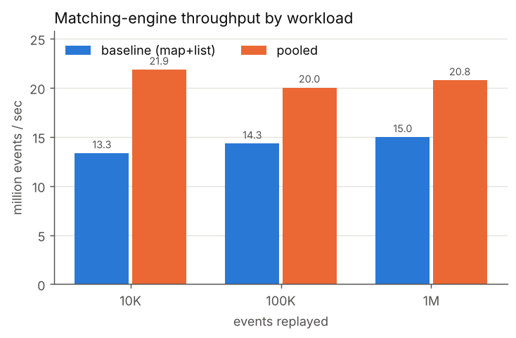
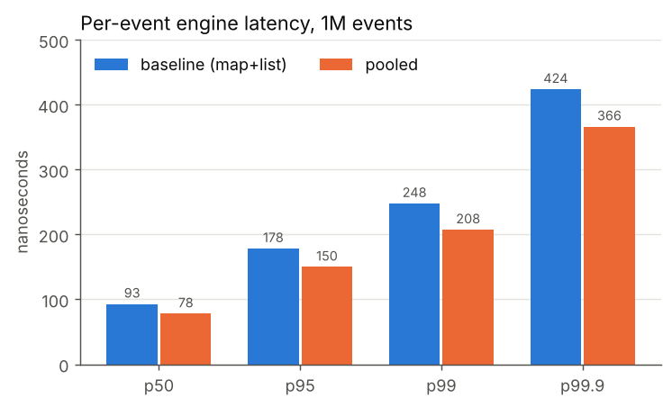
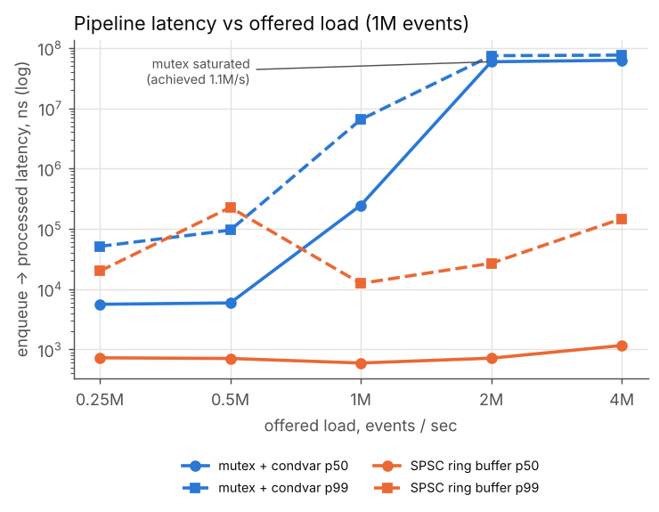

# Aquila: High-Performance Limit Order Book & Matching Engine

Aquila is a simulated exchange matching engine written in C++20. It takes a stream of
buy/sell orders, cancels and modifications, keeps a limit order book, matches orders
with **price-time priority**, emits trades, and measures its own throughput and
latency.

The project is a systems/performance exercise. The interesting parts are the data
structures in the order book, the matching algorithm, the concurrency model, and two
profile-driven optimizations whose before/after numbers are measured, not estimated.

```
$ ./aquila --events 1000000
Mode:              single (pooled book)
Events processed:  1,000,000
Trades executed:   205,714
Shares executed:   25,959,400
Wall time:         0.0518938 s
Throughput:        19,270,126 events/sec
Latency (engine service time per event):
  average:         93 ns
  p50:             80 ns
  p95:             163 ns
  p99:             231 ns
  p99.9:           406 ns
  max:             141.96 us
```

Every number in this README was produced by the code in this repository on the
machine described under [Performance](#performance). Raw output is in `data/`.

---

## Architecture

```
 EventGenerator ──► EventQueue ──► MatchingEngine ──► Trades
 (seeded, synthetic)  (mutex or SPSC)   │                └► stats / latency samples
                                         ▼
                                     OrderBook  (MapListOrderBook | PooledOrderBook)
```

| Component | File | Role |
|---|---|---|
| `Order`, `Trade` | `include/order.hpp` | Integer prices in ticks (101.25 → 10125), quantities, sequence numbers |
| `OrderBookLike` concept | `include/order_book.hpp` | The contract every book implements |
| `MapListOrderBook` | `include/order_book.hpp`, `src/order_book.cpp` | Baseline, textbook design |
| `PooledOrderBook` | `include/pooled_order_book.hpp`, `src/pooled_order_book.cpp` | Optimized, allocation-free design |
| `FlatIdMap` | `include/flat_id_map.hpp` | Open-addressing id → order index map |
| `BasicMatchingEngine<Book>` | `include/matching_engine.hpp` | Price-time matching, cancel, modify |
| `EventGenerator` | `include/event_generator.hpp` | Deterministic synthetic market events |
| `MutexQueue`, `SpscRingBuffer` | `include/event_queue.hpp` | Swappable producer/consumer queues |
| pipeline runners | `include/pipeline.hpp` | Single-threaded and two-thread replay with latency capture |
| `aquila` | `src/main.cpp` | CLI driver |

### Design decisions

**Integer prices.** Prices are `int64` ticks (cents). Comparisons are exact, prices
work as map keys, and there's no floating-point rounding in the matching path.

**The engine is a template over the book.** `BasicMatchingEngine<Book>` requires
`OrderBookLike<Book>` (a C++20 concept). Swapping the data structure is a type change:
no virtual calls on the hot path, and both books run through the same tests and
benchmarks. `matching_engine.cpp` explicitly instantiates both, so other translation
units don't recompile the template.

**Matching rules.**
- An incoming order trades against the opposite side while it crosses
  (buy ≥ best ask, or sell ≤ best bid).
- Executions happen at the **resting (maker) order's price**.
- Within a price level the oldest order fills first.
- Any remainder rests in the book.
- **Modify:** reducing quantity at the same price keeps time priority. Changing the
  price or increasing the quantity is cancel + re-add, so the order moves to the back
  of the queue and can trade immediately if the new price crosses. This mirrors how
  most real venues treat amendments.
- Rejected: zero quantity, non-positive price, and an add whose id is already
  resting. Cancel/modify of an unknown, filled or cancelled id returns `NotFound`.

**Baseline book (`MapListOrderBook`).**
- Price levels: `std::map`, with bids ordered high→low and asks low→high, so the best
  price is `begin()`.
- Each level holds a FIFO `std::list<Order>`.
- An `std::unordered_map<OrderId, list iterator>` gives O(1) cancel and modify.

This is the obvious correct design and the reference point for optimization.

**Optimized book (`PooledOrderBook`).** Same contract; only the memory layout differs.
1. Orders live in one `std::vector<Node>` pool with a free list. Nodes are addressed by
   32-bit index, so the pool can grow without invalidating links.
2. Each level's FIFO is an intrusive doubly-linked list threaded through the pool.
3. Each side's levels are a `std::vector<Level>` sorted so the **best price is at the
   back**. Top of book is `back()`. Since most activity is near the touch, inserting or
   erasing a level shifts only a few elements.
4. Id lookup uses `FlatIdMap`: linear probing, Fibonacci hashing, and backward-shift
   deletion, so heavy add/cancel churn never leaves tombstones in the probe chains.

In steady state the optimized book makes **zero heap allocations per event**.

**Concurrency.** `runPipeline<Queue>` runs a producer thread that stamps each event,
a queue, and a consumer thread that runs the engine. The queue is a template parameter
constrained by a `BlockingQueue` concept.
- `MutexQueue` is a bounded `std::deque` guarded by `std::mutex` and two
  `std::condition_variable`s.
- `SpscRingBuffer` uses acquire/release atomics with a power-of-two capacity, so
  wrap-around is a mask. Head and tail sit on separate cache lines, and each side
  caches the other's index so the shared atomic is only re-read when the queue looks
  full or empty.

The engine itself stays single-threaded, as a real matching engine for one instrument
would be. Concurrency sits at the boundary.

---

## Build

Requirements: a C++20 compiler (tested with GCC 13), CMake ≥ 3.20, and Python 3 for
analysis (standard library only; matplotlib is optional and only needed for plots). GoogleTest and Google Benchmark
are fetched from GitHub at configure time.

```bash
mkdir build
cd build
cmake ..                      # Release by default
cmake --build . -j
```

Offline build with local checkouts of the two libraries:

```bash
cmake .. -DFETCHCONTENT_SOURCE_DIR_GOOGLETEST=/path/to/googletest \
         -DFETCHCONTENT_SOURCE_DIR_BENCHMARK=/path/to/benchmark
```

Options:
- `-DAQUILA_SANITIZE=ON` builds with AddressSanitizer + UBSan.
- `-DAQUILA_NATIVE=ON` adds `-march=native`.
- `-DAQUILA_BUILD_TESTS=OFF` / `-DAQUILA_BUILD_BENCHMARKS=OFF` skip those targets.

## Run

```bash
./aquila --events 1000000                         # single-threaded, pooled book
./aquila --events 1000000 --book baseline         # baseline book
./aquila --events 1000000 --mode spsc             # generator thread -> SPSC ring -> engine
./aquila --events 1000000 --mode mutex --rate 500000   # paced producer, 500K events/s
./aquila --events 1000000 --csv ../data/runs.csv  # append a result row
./aquila --events 20 --dump events.txt            # write the event stream as text
./aquila --help
```

Event text format, with prices in ticks:

```
ADD BUY 10001 10125 200     # order 10001, buy 200 @ 101.25
CANCEL 10001
MODIFY 10001 10130 150      # new price 101.30, new open quantity 150
```

In single-threaded mode the CLI makes two passes over identical input. An untimed pass
gives throughput, then a fresh engine with per-event timing gives the latency
distribution. Timing every event costs about 26 ns, so mixing the two would understate
throughput.

## Testing

```bash
cd build
ctest --output-on-failure        # or: ./aquila_tests
```

There are 88 tests. Every order-book and engine test is a typed test that runs against
**both** book implementations.

- **Order book:** inserting buys and sells, best bid/ask, empty book, FIFO within a
  level, cancel from the middle of a level, level removal, unknown ids, duplicate ids,
  in-place reduce, id reuse after cancel.
- **Matching engine:**
  - both spec examples
  - full and partial fills
  - multi-level sweeps
  - time priority
  - execution at the maker price
  - the limit price stopping a sweep
  - cancelled orders never trading
  - modify keeping or losing priority
  - modify into a cross
  - invalid and duplicate ids
- **FlatIdMap:** a 400K-step randomized differential test against
  `std::unordered_map`.
- **Generator:** same seed gives an identical stream, different seeds differ, the event
  mix, the live-order bound, and prefill never crossing.
- **Queues:** in-order delivery across threads with a small capacity (to force the
  full and empty paths), close semantics, and draining after close. A pipeline run
  must produce exactly the same trades and book as single-threaded replay.
- **Integration:**
  - 60K generated events are checked **event by event** against an independent
    brute-force reference exchange (a flat vector, linear scans, no shared code). Every
    trade must match, and the full book is compared every 500 events.
  - A 250K-event replay checks these invariants: the book is never crossed at rest,
    `0 < remaining ≤ quantity`, cancelled orders never trade, trade ids are contiguous,
    and trade records sum to the engine's executed volume.

The suite also passes under ASan + UBSan (`-DAQUILA_SANITIZE=ON`), and the queue and
pipeline tests pass under ThreadSanitizer (`-DCMAKE_CXX_FLAGS=-fsanitize=thread`).

## Benchmarking

```bash
scripts/run_benchmarks.sh build            # ~6 min; writes data/*.json, data/aquila_runs.csv
python3 python/analyze_benchmarks.py       # summary tables, data/benchmark_results.csv, data/plots/
```

| Binary | Measures |
|---|---|
| `order_book_benchmark` | add+cancel, and cancel-random+re-add, against books of 100 / 1K / 10K orders; top-of-book query |
| `matching_engine_benchmark` | full replay of 10K / 100K / 1M events (throughput); the same with every event timed (mean/p50/p95/p99/p99.9); replay with live orders capped at 100 / 1K / 10K; clock overhead |
| `queue_benchmark` | raw two-thread handoff of 1M integers; full generator → queue → engine pipeline |
| `alloc_profile` | heap allocations and bytes per event in steady state (replaces global `operator new`) |
| `tools/ab_compare.py` | interleaved A/B runs of two benchmark binaries, robust to machine drift |

Events are generated once per configuration, before timing starts. The generator is
seeded (`--seed`, default 42) and maps raw `mt19937_64` output itself instead of using
`std::uniform_*_distribution`, so a seed gives the same stream on any standard library.

---

## Performance

**Machine:** 2 vCPU KVM guest, Intel Xeon @ 2.10 GHz, Linux 6.18, GCC 13.3, `-O3`
(CMake Release). It's a shared virtual machine, and throughput drifts by up to about
25% between runs. Because of that, Google Benchmark results are the **median of 10
randomly interleaved repetitions**, step-to-step comparisons use interleaved A/B runs,
and two-thread runs are the median of 3. Treat absolute numbers as specific to this
box; the ratios are the point.

### Matching engine (single thread)

| Workload | Baseline (map + list) | Pooled | Speedup |
|---|---|---|---|
| 10K events | 13.34 M events/s | 21.85 M events/s | 1.64× |
| 100K events | 14.31 M events/s | 20.02 M events/s | 1.40× |
| 1M events | 14.98 M events/s | 20.77 M events/s | 1.39× |

Per-event latency over 1M events:

| Engine | mean | p50 | p95 | p99 | p99.9 |
|---|---|---|---|---|---|
| Baseline | 99 ns | 93 ns | 178 ns | 248 ns | 424 ns |
| Pooled | 87 ns | 78 ns | 150 ns | 208 ns | 366 ns |

Each latency sample includes one `steady_clock` read, which measures 26 ns on this
machine, so absolute values are slightly pessimistic. The workload is 60% adds (15%
priced through the mid), 25% cancels and 15% modifies, and 1M events produce 205,714
trades.

Throughput by resting-book size (100K events):

| Live orders (cap) | Baseline | Pooled |
|---|---|---|
| ~100 | 15.48 M/s | 21.88 M/s |
| ~1K | 16.56 M/s | 21.57 M/s |
| ~10K | 14.45 M/s | 20.69 M/s |

Order-book operations (per add+cancel or cancel+re-add pair):

| Operation | Book size | Map + list | Pooled |
|---|---|---|---|
| add then cancel | 100 / 1K / 10K | 81.9 / 89.1 / 93.4 ns | 58.8 / 69.0 / 74.3 ns |
| cancel random then re-add | 100 / 1K / 10K | 94.1 / 100.6 / 137.2 ns | 67.0 / 76.9 / 99.7 ns |




### Optimization log

The optimization went in two steps, each driven by a profile. `perf` isn't available
inside this VM, so profiling used **callgrind** (instruction counts plus a simulated
branch predictor), Google Benchmark, and the allocation counter. Callgrind counts are
deterministic, which makes them a good complement to noisy wall-clock numbers.
Profiles cover only `MatchingEngine::process()` over 300K events
(`--toggle-collect`); reports are in `data/profiling/`.

On a bare-metal Linux box, the equivalent `perf` workflow is:

```bash
perf stat -e cycles,instructions,branch-misses,cache-misses ./aquila --events 1000000
perf record -g ./aquila --events 1000000 && perf report
```

#### Step 1: remove per-order heap allocation

1. **Original implementation:** `MapListOrderBook` (`std::map` + `std::list` +
   `std::unordered_map`).
2. **Observed bottleneck:** about 35% of the engine's instructions were inside
   `operator new` / `operator delete` / `malloc` / `free`, and another ~10% were in
   hash-table node handling and rehash-policy checks. `alloc_profile` counted
   **0.76 allocations and 33.5 bytes per event** in steady state, from list nodes, hash
   nodes, and map nodes for new price levels. Allocator calls also cost indirect-branch
   mispredictions (0.45M of them).
3. **Change made:** `PooledOrderBook`, with a pooled node array, intrusive FIFO lists,
   per-side vectors of price levels, and `FlatIdMap`. Price levels were located with
   `std::lower_bound`.
4. **Before:** 379 instructions/event, 4.2 conditional-branch mispredicts per event,
   0.76 allocations/event, 14.98 M events/s (1M replay).
5. **After:** 248 instructions/event (−35%), 4.1 mispredicts per event,
   **0 allocations/event**, and 14.87 → 18.56 M events/s on the 1M replay (1.25×),
   measured in the same interleaved A/B session as step 2
   (`data/profiling/ab_step1_vs_step2_engine.txt`).

#### Step 2: replace binary search with a scan from the best price

1. **Original implementation:** step 1, where price levels are found with
   `std::lower_bound`.
2. **Observed bottleneck:** the new profile showed `lowerBound` at about 20% of
   instructions and **58% of all conditional-branch mispredictions**. A binary search
   pays log₂(L) branches that are essentially coin flips.
3. **Change made:** a linear scan from `back()`, the best price, toward worse prices.
   Most adds, cancels and fills land near the touch, so the scan's loop branch is
   highly predictable.
4. **Before → after** (callgrind):
   - Instructions **rise** from 248 to 307 per event, because the scan does more work.
   - Conditional-branch mispredictions **fall** from 4.07 to 2.32 per event (−43%).
5. **Before → after** (interleaved A/B medians, wall-clock):
   - 1M replay: 18.56 → 19.70 M events/s (+6%)
   - 10K replay: 17.71 → 19.86 M events/s (+12%)
   - Add then cancel at book size 100: 31.5 → 33.5 M ops/s (+6%)

**What was learned**
- Allocation was the biggest single cost in the textbook design. Removing it bought
  more than any algorithmic change.
- Instruction count isn't time: step 2 executes *more* instructions and runs faster,
  because mispredicted branches cost far more than the extra cheap, predictable work.
- Asymptotic complexity misleads at this scale. The O(L) scan beats O(log L) because L
  is small (tens of levels) and access is skewed toward the top of the book. The
  trade-off is explicit: very deep books with activity far from the touch would favour
  the binary search or a tree. At a 10K-order book cap, step 2's gain shrinks to about
  6%.
- Best-of-N on a shared VM lies. Interleaved A/B runs reported as medians were
  necessary to separate a 6% effect from about 25% machine drift.

### Concurrency: mutex queue vs SPSC ring buffer

Raw two-thread handoff of 1M integers:

| Queue | Capacity 1,024 | Capacity 65,536 |
|---|---|---|
| `std::mutex` + `condition_variable` | 4.50 M items/s | 5.53 M items/s |
| SPSC ring (`std::atomic`, acquire/release) | 177.2 M items/s | 207.7 M items/s |

Full pipeline (generator thread → queue → engine thread, 1M events, producer unpaced):

| Queue | Throughput | p50 latency (queue full) |
|---|---|---|
| mutex | 1.14 M events/s | 59.5 ms |
| SPSC | 5.05 M events/s | 12.8 ms |

Latency vs offered load, measured from enqueue to the end of processing. These are
medians of 3 runs:

| Queue | Offered | Achieved | p50 | p99 |
|---|---|---|---|---|
| mutex | 250K/s | 250K/s | 5.6 µs | 51 µs |
| mutex | 500K/s | 500K/s | 5.9 µs | 95 µs |
| mutex | 1M/s | 1M/s | 246 µs | 6.5 ms |
| mutex | 2M/s | 1.10M/s (saturated) | 58.9 ms | 74.3 ms |
| SPSC | 250K/s | 250K/s | 726 ns | 20 µs |
| SPSC | 1M/s | 1M/s | 595 ns | 12 µs |
| SPSC | 2M/s | 2M/s | 716 ns | 27 µs |
| SPSC | 4M/s | 4M/s | 1.2 µs | 147 µs |



**What was learned**
- **Latency vs throughput.** Below saturation, latency is the cost of the handoff.
  Above it, latency is queue depth divided by service rate: the 65K-slot queue fills,
  and every event waits for everything ahead of it (tens of ms). A bounded queue keeps
  that finite; an unbounded one would grow without limit.
- **Mutex queue.** Its p50 of about 5 µs, even at light load, is the consumer sleeping
  on the condition variable and being woken through a futex syscall. It saturates
  around 1.1M events/s because every push and pop takes the lock and may signal.
- **SPSC ring.** It holds about 0.6 to 0.7 µs p50 up to 2M events/s, which is roughly
  the cost of moving a cache line between cores plus the clock reads. It costs a
  spinning consumer core, which is acceptable on a dedicated core and wasteful on a
  shared one. The pipeline tops out at about 5M events/s, below the engine's ~20M/s
  single-thread rate. The handoff, the 48-byte stamped event, and two clock reads per
  event dominate.
- **Tails.** p99.9 in the hundreds of µs to ms for both queues comes from the 2-vCPU
  VM preempting one of the two busy threads. On a dedicated, isolated core (`isolcpus`,
  thread pinning) these tails would be the first thing to re-measure.

---

## Project layout

```
Aquila/
├── include/            order.hpp, order_book.hpp, pooled_order_book.hpp, flat_id_map.hpp,
│                       matching_engine.hpp, event.hpp, event_generator.hpp,
│                       event_queue.hpp, latency.hpp, pipeline.hpp
├── src/                order.cpp, order_book.cpp, pooled_order_book.cpp, matching_engine.cpp,
│                       event.cpp, event_generator.cpp, event_queue.cpp, main.cpp
├── tests/              order_book_test.cpp, matching_engine_test.cpp, event_test.cpp,
│                       queue_test.cpp, integration_test.cpp, book_types.hpp
├── benchmarks/         order_book_benchmark.cpp, matching_engine_benchmark.cpp,
│                       queue_benchmark.cpp, bench_common.hpp
├── tools/              alloc_profile.cpp, ab_compare.py
├── python/             analyze_benchmarks.py
├── scripts/            run_benchmarks.sh
├── data/               raw benchmark JSON, aquila_runs.csv, benchmark_results.csv,
│                       alloc_profile.txt, plots/, profiling/ (callgrind reports, A/B runs)
└── CMakeLists.txt
```

## Possible extensions

- Kafka (or a socket/UDP feed) as an event source in front of the queue.
- Order types: market, IOC, FOK, post-only.
- Multiple instruments, each with one engine thread, sharded by symbol.
- Thread pinning and `isolcpus`, then re-measuring the SPSC tail latency.
- A batch-pop API on the queues, which amortizes synchronization and trades latency for
  throughput.
